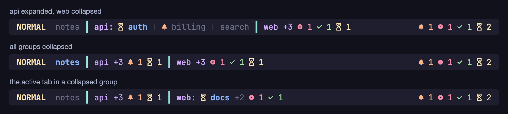

# ade-zjstatus

ade-zjstatus is a fork of [zjstatus](https://github.com/dj95/zjstatus) by Daniel Jankowski. It keeps everything
zjstatus does and adds two things to its tab bar, for running several coding agents in Zellij tabs: agent status
icons and tab groups.

> [!WARNING]
> Under development: none of this is released yet.



Both features need **Zellij 0.46 or newer**. Existing configs work unchanged: everything below is off until you
use it. See [examples/groups.kdl](./examples/groups.kdl) for a complete layout: the screenshot is its bar, drawn
by the plugin's own rendering code.

## Agent status

Zellij 0.46 tracks what the programs in each pane are doing: working, waiting for you, done or failed. Programs
report it themselves with the [OSC 7501](https://mitchellh.com/writing/program-status-osc7501) program status
protocol (OpenCode and Claude Code do, for example), and Zellij adds some statuses of its own, such as a long
shell command that finished. This fork shows those statuses in the bar.

| Placeholder | Where | Shows |
| --- | --- | --- |
| `{attention}` | tab formats (`tab_normal`, `tab_active`, ...) | the icon of the tab's most urgent status |
| `{attention_counts}` | tab formats | how many of the tab's panes have each status, e.g. `●1 ◐2` |
| `{attention}` | `format_left`, `format_center`, `format_right` | the counts for the whole session (the `attention` widget) |

Group labels have both placeholders too (see [Tab groups](#tab-groups)).

A status shows only if it has an icon. Without configuration, the four statuses Zellij counts use its own symbols.
Icons are format strings, so they can have their own colours. Whatever an icon leaves unset (foreground,
background, effects) it takes from the format around it.

| Option | Default | Meaning |
| --- | --- | --- |
| `attention_needs_you` | `●` | icon for a program waiting for you (a permission or a question) |
| `attention_failed` | `✗` | icon for failed |
| `attention_done` | `✓` | icon for done (Zellij keeps it until you have seen the pane) |
| `attention_working` | `◐` | icon for working |
| `attention_quiet` | none | icon for a command whose output went quiet |
| `attention_new_output` | none | icon for new output you haven't seen |
| `attention_count_format` | `{icon}{count}` | one count; the count and any text take the style of the icon's last part |
| `attention_count_separator` | a space | text between counts |
| `attention_source` | `all` | `all`: everything Zellij tracks; `program_status`: only statuses programs report with OSC 7501 |
| `attention_format` | `{counts}` | the `attention` widget: `{counts}`, and `{icon}` for the most urgent status. Empty when nothing has a status |

Set an icon to `""` to hide its status. Statuses are shown and picked in this order: needs you, failed, done,
working, quiet, new output.

With `attention_source "all"`, the counts come from Zellij's summary of each tab, which is empty if you turn off
`tab_markers` in Zellij's `attention` config. `attention_source "program_status"` counts each pane's status only if a
program reported it, which leaves out Zellij's own guesses (finished shell commands, new output).

For example, with [Nerd Font](https://www.nerdfonts.com) icons in Catppuccin Mocha colours (the trailing spaces
keep `{attention}{name}` tidy when a tab has no status):

```kdl
attention_needs_you "#[fg=#fab387] "
attention_failed    "#[fg=#f38ba8] "
attention_done      "#[fg=#a6e3a1] "
attention_working   "#[fg=#f9e2af]󰔟 "
attention_count_separator " "
attention_format    "{counts}"

tab_normal "#[fg=#6c7086] {attention}{name} "
tab_active "#[fg=#89b4fa,bold] {attention}{name} "
format_right "{attention}"
```

## Tab groups

Turn groups on with `tab_groups "true"`. A tab named `prefix: name` belongs to the group `prefix`. Grouping is
optional: tabs without a prefix stay plain tabs, and a group is shown only when at least two tabs share its prefix.
A single `api: auth` is a plain tab under its full name. Inside a group, tabs are shown without the prefix (while
you rename a tab, it shows its full name).

```
 notes ┃ api: ◐auth ⋮ billing ⋮ search ┃ web +3 ●1 ◐1
```

Here `api` is expanded and `web` is collapsed: it shows how many tabs it has and the statuses in them. When the
active tab is in a collapsed group, the bar shows the group's label, the active tab and the hidden tabs, e.g.
`web: ◐search +2 ●1`.

- **Clicking** a group's label expands or collapses it, without leaving your tab. Clicking a tab goes to it.
  Clicking a group's status counts goes to its most urgent tab.
- **Collapsing** is manual: groups start expanded, or collapsed with `tab_group_start_collapsed "true"`. With
  `tab_group_collapse "auto"`, only the group of the active tab is expanded, and clicking a collapsed group goes to
  it.
- **Keeping groups together.** A group's tabs are moved next to each other, at the place of its first tab. A new
  `api:` tab at the end of the bar moves straight to the other `api` tabs. This keeps the bar's order the same as
  Zellij's, so moving between tabs and the tab numbers follow the bar. Tabs don't move while you rename one.

  The bar moves tabs through Zellij's plugin API, so turning groups on asks for one more permission: "Execute
  actions as the user". A move puts a tab at a position, so repeating it changes nothing, and a move that changed
  nothing isn't repeated until the tabs change. With `tab_group_keep_together "false"`, nothing moves, no extra
  permission is needed, and only neighbouring tabs are grouped.
- **Many tabs.** `tab_display_count` counts groups and plain tabs, not tabs, and the truncation formats' `{count}`
  is the number of groups and plain tabs left out.

Expanded and collapsed groups are remembered for each session while Zellij runs. Zellij deletes the plugin's data
when it unloads the plugin, so they reset when Zellij restarts.

| Option | Default | Meaning |
| --- | --- | --- |
| `tab_groups` | `false` | `true` turns groups on |
| `tab_group_delimiter` | `:` | what separates the prefix from the name |
| `tab_group_collapse` | `manual` | `manual` or `auto` (only the active tab's group is expanded) |
| `tab_group_start_collapsed` | `false` | `true`: groups start collapsed (manual mode) |
| `tab_group_keep_together` | `true` | move a group's tabs next to each other |
| `tab_group_expanded` | ` {name}:` | label in front of an expanded group's tabs |
| `tab_group_collapsed` | ` {name} +{count} {attention_counts} ` | a collapsed group without the active tab |
| `tab_group_collapsed_active` | `tab_group_expanded` | label in front of the active tab of a collapsed group |
| `tab_group_hidden` | `+{count} {attention_counts} ` | after the active tab of a collapsed group: its other tabs |
| `tab_group_separator` | `tab_separator` | separator next to a group; `tab_separator` stays the separator between tabs |

Labels can use `{name}` (the prefix), `{count}`, `{attention}` and `{attention_counts}`. In `tab_group_hidden` they
cover the hidden tabs; in the labels, all the group's tabs. Group tabs use the usual tab formats.

> [!NOTE]
> zjstatus reads a `]` in a format as the end of a `#[...]` style, so don't use `]` as text in formats.

### Keyboard

The bar listens for these messages, from a keybinding or `zellij pipe`. Without a group name, they apply to the
group of the active tab. They do nothing in `auto` mode.

| Message | Does |
| --- | --- |
| `zjstatus::groups::toggle` | expands or collapses the active tab's group |
| `zjstatus::groups::toggle::NAME` | expands or collapses the group `NAME` |
| `zjstatus::groups::collapse[::NAME]` | collapses it |
| `zjstatus::groups::expand[::NAME]` | expands it |
| `zjstatus::groups::collapse_all` | collapses all groups |
| `zjstatus::groups::expand_all` | expands all groups |
| `zjstatus::groups::toggle_all` | collapses all groups if any is expanded, otherwise expands them all |

A keybinding sends one with `MessagePlugin`; without a plugin URL it goes to every plugin, and the bar in the
active tab acts on it. For example, in tab mode of Zellij's `config.kdl`:

```kdl
keybinds {
    tab {
        bind "g" { MessagePlugin { name "zjstatus"; payload "zjstatus::groups::toggle"; }; }
        bind "G" { MessagePlugin { name "zjstatus"; payload "zjstatus::groups::toggle_all"; }; }
    }
}
```

From a shell: `zellij pipe "zjstatus::groups::toggle::api"`.

## Compatibility

- All of upstream's options and widgets keep working, so existing configs work unchanged. The
  [upstream wiki](https://github.com/dj95/zjstatus/wiki) documents them.
- Releases need Zellij 0.46 or newer.
- Tab groups ask for one more permission ("Execute actions as the user") to move tabs, unless
  `tab_group_keep_together` is `false`. Configs without groups ask for the same permissions as upstream.
- The plugins keep upstream's file names (`zjstatus.wasm`, `zjframes.wasm`) and its `zjstatus::` pipe messages,
  so switching between upstream and this fork only means changing the download URL.

## Versions

A release is tagged with the upstream release it is based on plus a fork counter: `v0.25.0-ade.1`,
`v0.25.0-ade.2`, then `v0.26.0-ade.1` after merging upstream 0.26.0. Upstream's own tags are never pushed to this
repository.

`just release` (it needs [cargo-edit](https://github.com/killercup/cargo-edit) for `cargo set-version`) picks the
next version, sets it in `Cargo.toml`, commits, tags and pushes. The tag starts the release workflow, which builds
both plugins and creates a draft release, with notes GitHub writes from the merged pull requests, to publish by
hand.

## Keeping up with upstream

```sh
git remote add upstream https://github.com/dj95/zjstatus.git   # once
git fetch upstream --tags
git merge upstream/main
```

To keep these merges easy, change upstream's files as little as possible: put new features in new files where
that works, and document the fork here rather than in the README. The fork's code is in `src/attention.rs`,
`src/tab_groups.rs`, `src/widgets/attention.rs` and `src/widgets/tabs/grouped.rs`, with small hooks in upstream's
files.

## Development

See [Development](./README.md#-development) in the README. `examples/screenshot.sh` redraws the screenshot above
from `examples/groups.kdl` (it needs wasmtime, Python 3, ImageMagick, Google Chrome and JetBrainsMono Nerd Font).
